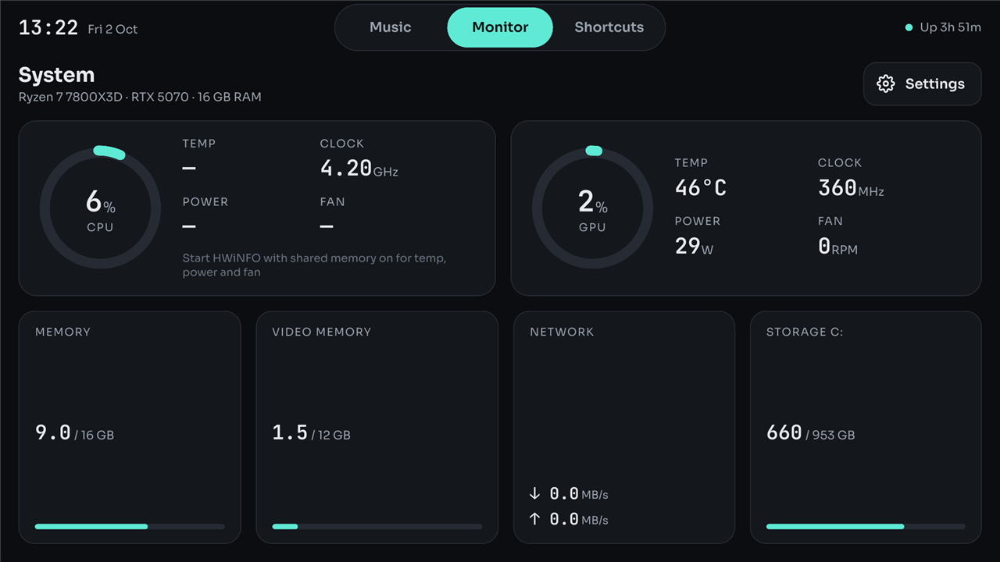
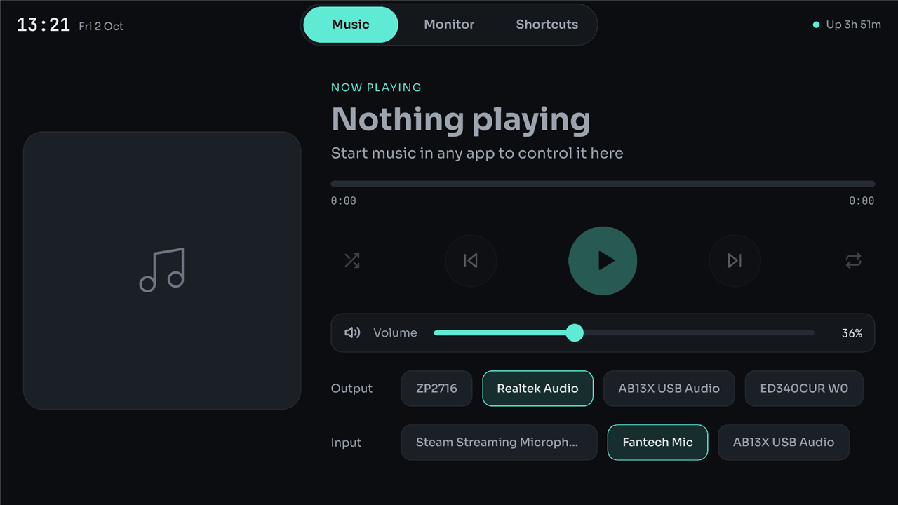
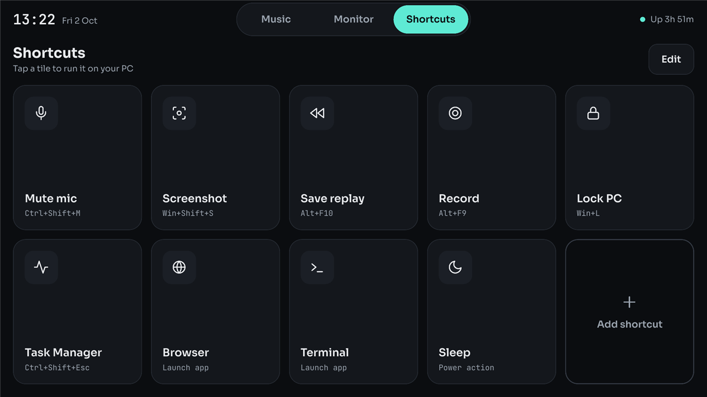
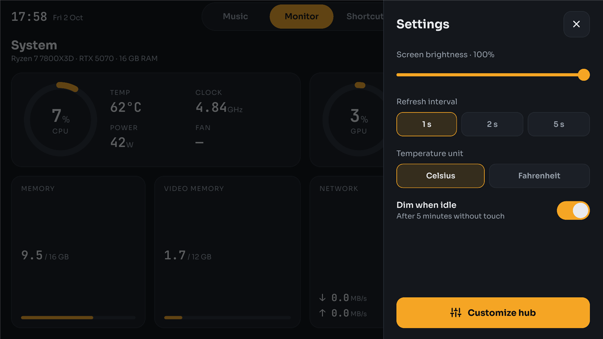
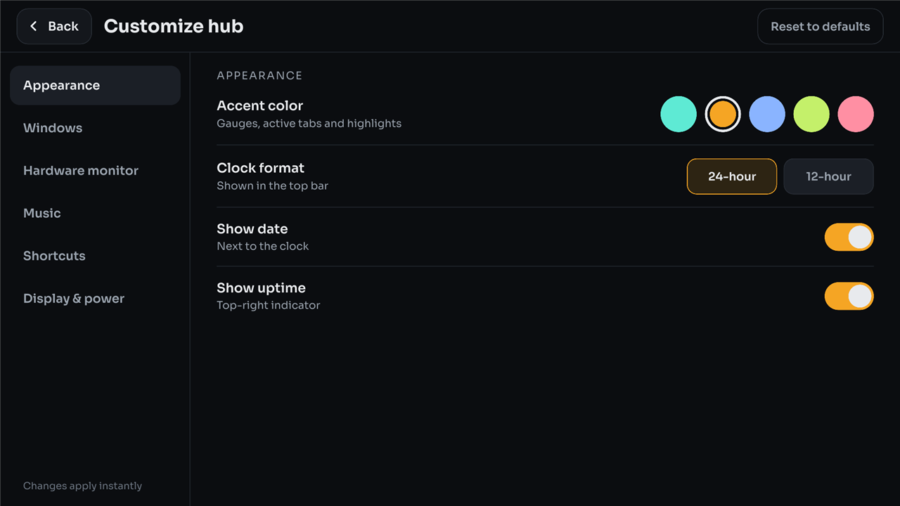

# PC Hub

A touch dashboard for a small secondary screen next to your PC. Three pages you swipe
between: music and audio controls, a live hardware monitor, and a grid of shortcut tiles.
Built with Rust and [Slint](https://slint.dev) for Windows.



| Music | Shortcuts |
|---|---|
|  |  |
| **Settings** | **Customize hub** |
|  |  |

## Features

**Music**
- Now playing from any app that shows up in the Windows volume flyout (Spotify, browsers,
  most media players), with album art, track progress and elapsed/total time
- Play/pause, previous, next, shuffle and repeat (greyed out when the app doesn't support them)
- With several players open, choose which one the controls act on
- Tap or drag along the progress bar to jump in the track
- System volume slider, with mute buttons for the sound and the microphone
- A mixer with a volume slider and mute button for each app playing sound
- One-tap switching of the default **output** device (speakers, headphones, monitors)
  and **input** device (microphones)
- A live level meter for the microphone under Input
- A Like button for Spotify (it presses Spotify's own Like shortcut)
- Optionally, the accent color follows the album art while music plays

**Monitor**
- Processor and graphics card load gauges, with temperature, clock, power and fan speed
- Memory, video memory, network speed, and usage of the system drive or the drives you list
- Temperatures in Celsius or Fahrenheit; turn amber when running hot, and the card's
  outline pulses when one stays hot for 30 seconds
- Graphs of the last minute behind the processor, graphics card and network readings
- Tap the processor or graphics card to see the busiest apps, and end one if it's stuck
- Today's and this month's downloads and uploads, and how long a server takes to answer, on
  the network card
- Graphics card readings for AMD and Intel cards too (through HWiNFO), with the hot spot
  and memory temperatures where the card reports them
- The frame rate of the game in front, when RivaTuner Statistics Server (part of MSI
  Afterburner) is running
- Battery levels of wireless headsets, controllers and phones that report them to Windows
- A card of its own for any HWiNFO reading: water temperature, pump speed, motherboard
  sensors, picked from a list on the hub

**Shortcuts**
- Tiles that press a key combination (Discord mute, NVIDIA replay, Snipping Tool),
  lock, sleep, hibernate, shut down or restart the PC, sign out, turn the screens off,
  empty the Recycle Bin, switch power plan, or open any app, file, folder, website or
  settings page
- Tiles for apps, files and folders show their real icons
- Command tiles run PowerShell and show what it prints, on a tap or every so often
- Web tiles call an address (Home Assistant, OBS, any HTTP API) and show the answer
- Macro tiles run several steps in order: keys, actions, apps, commands, web calls, pauses
- Shortcut pages (say, Gaming and Work) with chips to switch between them; a page can
  turn on by itself while one of its apps is running
- Mute tiles for the microphone or the sound, and a Windows dark mode tile, that light up
  while on
- Shut down, restart, sign out and emptying the Recycle Bin ask for a second tap, so a
  stray touch can't trigger them
- Drag a file, folder, app or internet shortcut from Explorer, or a link from a browser,
  onto the hub to make a tile
- Tiles that switch Wi-Fi, Bluetooth, night light and Do Not Disturb, lit while on
- A second action for a tile, run by pressing and holding it
- Folder tiles that open a group of more tiles
- Add and edit tiles on the hub: name, icon, page, and keys to press, an action, or
  something to open, typed on an on-screen keyboard
- Press and hold a tile, then drag it to reorder; delete tiles in Customize hub.
  `hub.toml` is updated to match
- Edits to `hub.toml` show up within two seconds, without restarting

**Widgets**
- Today's and tomorrow's events from Google Calendar or Outlook (their calendar links)
- Windows notifications from the apps you choose, which can be dismissed from the hub
- Clipboard history: tap text you copied to paste it into the app in front
- Discord voice: who's in your channel and who's talking, with mute and deafen
- OBS: switch scenes, start and stop recording and streaming, and see for how long

**Customize hub**
- A full-screen settings window, all adjustable by touch and applied instantly: dark or
  light theme (or following Windows), accent color (five presets, or any hex code typed
  on an on-screen keypad), 12/24-hour clock, which pages and Monitor cards appear, the page it
  opens on, swipe and slide animation, the heat-warning temperature, album art and
  device buttons, key-combination hints, history graphs, brightness, idle dimming and
  the idle clock, going dark while the PC is locked, which screen it opens on, full
  screen or windowed, and starting with Windows

**Everywhere**
- Tapping the hub never takes focus away from the app in front, so full-screen games
  stay put and key-combination tiles reach them
- Opens full screen on the screen you pick on the hub, or as a window you can move by its
  top bar and resize from its corner (or any edge, with a mouse); it snaps to screen edges
  and reopens where you left it
- Optional hotkeys on your main keyboard show a page of the hub from any app
- Tap the clock for a countdown timer (with a sound when it's done), a stopwatch, and
  Pomodoro focus and break rounds
- The weather for a place you choose and, on laptops, the battery level in the top bar
- While idle with music playing, the dim clock shows the album art and track
- An icon in the notification area to show, restart or quit the hub
- Back up hub.toml and the hub's settings, and restore a backup, from Customize hub
- Says when a newer version is published on GitHub
- Release builds write their messages to `pc-hub.log` beside `pc-hub.exe`
- Profiles: save the shortcuts and settings under a name (Gaming, Work) and switch on the hub
- English, German, Spanish and French, following Windows or picked on the hub
- A portrait layout for screens mounted on their side
- Turns the monitor's own backlight down (DDC/CI) instead of darkening the picture, when
  the monitor supports it

## Requirements

- Windows 10 or 11
- A second screen for the hub. A touch screen works best, but a mouse works too
- Optional: [HWiNFO](https://www.hwinfo.com) for processor temperature, power and fan speed
- Optional: an NVIDIA graphics card, or HWiNFO, for graphics card readings
- Optional: RivaTuner Statistics Server (comes with MSI Afterburner) for the frame rate

## Getting started

### 1. Build it

Each [release](https://github.com/sudpmishra/PC-Hub/releases) has a setup program,
`pc-hub-setup-<version>.exe`, once one is published. It installs for your account only (no
admin prompt) into `%LOCALAPPDATA%ProgramsPC Hub`, can start the hub when you sign in,
and keeps your `hub.toml` when upgrading; skip to step 2 after running it. There's also a
zip with just the files. To build it yourself, you need Rust (install from https://rustup.rs) and the Microsoft C++ build tools, which
Rust uses for linking on Windows:

```
winget install Microsoft.VisualStudio.2022.BuildTools --override "--wait --passive --add Microsoft.VisualStudio.Workload.VCTools --includeRecommended"
```

Then get the code and build it:

```
git clone https://github.com/sudpmishra/PC-Hub.git
cd PC-Hub
cargo run              # try it out; keeps a console window open for log messages
cargo build --release  # the finished app, at target\release\pc-hub.exe
```

The first build takes a few minutes; after that, rebuilds take seconds.

### 2. Point it at your touch screen

Out of the box the hub opens on your main screen. To move it to the touch screen, open
`hub.toml`, uncomment `x` and `y` under `[window]` and set them to the top-left corner of
the touch screen in Windows desktop coordinates (physical pixels). Settings > System >
Display shows how your screens are arranged. For example, for a touch screen to the right
of a 1920-pixel-wide main monitor, `x` is 1920, and `y` is how far down its top edge sits
(0 if the tops line up).

If touches land on the wrong monitor, open Control Panel > Tablet PC Settings > Setup
and tap the touch screen when prompted.

### 3. Install it

1. Make a folder, such as `C:\Tools\PC Hub`.
2. Copy `target\release\pc-hub.exe` and `hub.toml` into it. The hub reads `hub.toml` from
   its own folder first (then from the current folder), and saves its settings beside it.
3. To start it with Windows, run it from that folder and turn on **Start with Windows**
   under Customize hub > Display & power. (If you added a shortcut to `shell:startup`
   before, delete it, or the hub will open twice.)

### 4. Turn on processor sensors (optional)

Windows has no standard way to read processor temperature, power or fan speed, so the hub
takes them from [HWiNFO](https://www.hwinfo.com). Until HWiNFO is running, those readings
show "—" and the processor card says so.

1. Install HWiNFO64 and start it in **Sensors-only** mode.
2. Open its settings and tick **Shared Memory Support**.
3. To have it start with Windows, also tick **Auto Start** and **Minimize Sensors on Startup**.

The free version of HWiNFO switches shared memory off after 12 hours; tick it again
or restart HWiNFO when the readings go back to "—".

HWiNFO also provides the processor's real working clock (the average across cores).
Without it, the clock shown is the one Windows reports, which is often the base clock.

The processor fan is found by looking for "CPU" in its name. Many motherboards call it
something like "System 1" instead; find it in HWiNFO's sensor list and name it in
`hub.toml`:

```toml
[sensors]
cpu_fan = "System 1"
```

Graphics card readings need nothing extra on NVIDIA cards: they come from the driver.
Other brands show "—".

## Using it

- **Switch pages** by tapping Music, Monitor, Shortcuts or Widgets at the top, or swiping
  left or right anywhere. The hub opens on Monitor.
- **Music:** start something playing in any app and it appears here. Tap or drag along
  the progress bar to jump in the track. Tap the speaker beside the volume slider to mute,
  and the microphone button at the end of the Input row to mute the mic; both turn amber
  while muted. Tap a device under Output or Input to make it the Windows default; the
  highlighted one is current. **Apps** at the end of the volume row opens a mixer with a
  slider and mute button for each app playing sound. With more than one player open,
  chips beside "Now playing" pick which one the controls act on; **Auto** lets Windows
  pick, as its volume flyout does.
- **Settings:** tap Settings on the Monitor page for brightness, refresh interval,
  temperature unit and idle dimming. Tap outside the sheet or the X to close it.
- **Customize hub:** the button at the bottom of the Settings sheet opens every option,
  grouped into Appearance, Windows, Hardware monitor, Music, Shortcuts, and Display &
  power. **Back** returns to the hub; **Reset to defaults** undoes everything.
  **Close hub** (under Display & power) quits the app.
- **Shortcuts:** tap a tile to run it; the line under the page title confirms what ran.
  Shut down, restart and sign out tiles say "Tap again to confirm" first. To reorder,
  press and hold a tile until it lifts, drag it to a new place and let go. To add a
  tile, drag a file, folder, app or internet shortcut from Explorer onto the hub.
  **Edit** and **Add shortcut** open the Shortcuts section of Customize hub. There, each
  tile's **Edit** (or **+ Add shortcut**) opens the tile editor: type a name on the
  on-screen keyboard, pick what it does (keys to press, a built-in action, or something to
  open: an app, folder, website or URI), an icon, and its page, then **Save**. A physical
  keyboard types into the on-screen one too: while it's open the hub takes keyboard focus
  (Enter applies, Esc cancels), then hands focus back to the app that had it. Commands, web
  requests and macros keep what they do; set those with **Open hub.toml** (Notepad).
  **Delete** removes a tile after a second tap. When `hub.toml` puts tiles on pages, the
  page names show beside **Edit**; tap one to switch.
- **Hold actions and folders:** a tile with a `hold` action (it shows HOLD in its corner)
  does that action when you press and hold it, then let go without dragging. A folder tile
  opens its tiles over the page; tap outside to close it.
- **Widgets:** the Widgets page has cards for the calendar, notifications, clipboard,
  Discord and OBS. Choose which show under Customize hub > Widgets. Clipboard history is
  off until you turn it on there or on its card; copied text is only kept in memory, and
  what password managers copy is skipped.
- **Timer and stopwatch:** tap the clock. Pick a length (1 to 45 minutes) to start the
  timer, or switch to Stopwatch. A running one shows in place of the date; when the timer
  ends, the hub plays Windows' notification sound and shows "Time's up" until dismissed.
  **Focus** runs Pomodoro rounds: 25 minutes of focus, then a 5-minute break (15 after
  every fourth), each starting by itself with a sound.
- **Busiest apps:** tap the CPU or GPU card for the apps using the most processor or
  memory, each app's processes added together. **End** closes all of an app's processes
  after a second tap.
- **Choosing the screen:** under Customize hub > Display & power, tap a screen under
  **Screen** to move the hub there. Screens are numbered from left to right.
- **Windowed mode:** turn off **Full screen** under Customize hub > Display & power. Drag
  the top bar to move the hub (it snaps to screen edges) and the grip in the bottom-right
  corner to resize it; with a mouse, any edge resizes it too. It reopens at the same place
  and size.
- **Theme:** Customize hub > Appearance > Theme picks dark, light, or **Windows** to
  follow the app mode set in Windows' Settings > Personalization > Colors.
- **Weather:** under Customize hub > Appearance, tap **Set place** and type a town or city
  on the on-screen keyboard. The row then shows the place found and its weather, or why
  it couldn't be looked up. **Show weather** hides or shows it in the top bar. Tap the
  weather in the top bar for details: feels-like, humidity, wind, chance of rain, sunrise
  and sunset, and the next five days.
- **Profiles:** Customize hub > Display & power > Profiles > **Save as…** keeps the
  current `hub.toml` and settings under a name, in a `profiles` folder. **Switch** loads
  another; changes made while a profile is in use are kept with it.
- **Monitor backlight:** Customize hub > Display & power > **Use the monitor's backlight**
  turns the screen's real brightness down (and right down while dimmed) over DDC/CI. The
  row says whether the monitor took it; if not, the hub darkens the picture as before.
- **Sensor cards:** Customize hub > Hardware monitor > **+ Add a sensor card** lists every
  HWiNFO reading; tap one to give it a card on the Monitor page.
- **Language:** Customize hub > Appearance > Language. Messages that come from Windows or
  other apps stay as they are.
- **Backups:** Customize hub > Display & power > **Back up now** copies `hub.toml` and
  `hub-settings.toml` into a `backups` folder beside them (the newest 10 are kept). The
  newest five show below it; **Restore** puts one back after a second tap, backing up the
  current files first so it can be undone.
- **Updates:** Customize hub > Display & power shows the version and, once a day, whether a
  newer one is out, with a **Download** button. Turn the switch off to stop checking.
- **Notification area:** the PC Hub icon there shows the hub (left click) or, from its
  menu, restarts or quits it.
- **Dimmed screen:** after the idle time (5 minutes by default) without a touch, the
  screen darkens and shows a dim clock (turn off **Clock when idle** to hide it). The
  first tap only wakes it. With "Screen off when PC locks" on, it also goes dark while
  Windows is locked.

## Configuration

Everything lives in `hub.toml`, and changes apply within two seconds of saving it.
Choices made on the hub (accent, full screen, screen) win over the file.

```toml
columns = 5              # shortcut tiles per row
accent = "#5EEAD4"       # highlight color, unless another is picked on the hub
drives = ["C:", "D:"]    # drives on the storage card; leave out for the system drive

[window]
x = 1920                 # top-left corner of the touch screen, unless one is picked on the hub
y = 0
fullscreen = true        # the Full screen switch on the hub overrides this

[hotkeys]                # keys that show a page of the hub from any app; all optional
music = "Ctrl+Alt+1"
monitor = "Ctrl+Alt+2"
shortcuts = "Ctrl+Alt+3"
widgets = "Ctrl+Alt+4"

[network]
latency_host = "1.1.1.1" # the server whose answer time shows on the network card; "" hides it

[weather]                # the weather in the top bar, from Open-Meteo; leave out to hide it
place = "Amsterdam"      # or latitude = 52.37 and longitude = 4.89
```

The weather is looked up every 15 minutes and shows in the temperature unit picked on the
hub. You can also set the place on the hub, under Customize hub > Appearance > Weather
place; a place typed there wins over this one.

Hotkeys use the same key names as shortcut `keys` (below), and also wake a dimmed screen.
A combination another app already uses can't be taken; the hub skips it and notes it in
`pc-hub.log`.

### Output and input buttons

By default the Music page shows up to four connected devices of each kind. To choose which
ones appear and what they're called, list them. `device` is any part of the name Windows
shows in Settings > System > Sound; devices that aren't plugged in are hidden.

```toml
[[output]]
label = "Speakers"
device = "Realtek"

[[output]]
label = "Headphones"
device = "USB Audio"

[[input]]
label = "Desk mic"
device = "Microphone"
```

### Shortcuts

Each `[[shortcut]]` does one of these things:

```toml
[[shortcut]]
label = "Mute mic"
icon = "mic"
keys = "Ctrl+Shift+M"            # press a key combination

[[shortcut]]
label = "Lock PC"
icon = "lock"
action = "lock"                  # a built-in action (see the list below)

[[shortcut]]
label = "Internet"
icon = "globe"
command = "if (Test-Connection 1.1.1.1 -Count 1 -Quiet) { 'Online' } else { 'Offline' }"
refresh = 60                     # optional: also run it every 60 seconds

[[shortcut]]
label = "Desk lamp"
url = "http://homeassistant.local:8123/api/services/light/toggle"   # call a web address
body = '{"entity_id": "light.desk"}'
headers = { Authorization = "Bearer YOUR-TOKEN" }

[[shortcut]]
label = "Go live"
icon = "record"
steps = [                        # a macro: steps run in order
  { keys = "Ctrl+Shift+M" },
  { run = "obs64" },
  { wait = 3 },
  { keys = "Ctrl+F12" },
]
page = "Streaming"               # optional: only on this shortcut page

[[shortcut]]
label = "Sound settings"
icon = "speaker"
run = "ms-settings:sound"        # open an app, file, folder, website or URI
# args = ["--flag", "value"]     # optional arguments for run
```

- **keys**: names joined with `+`. Modifiers `Ctrl`, `Shift`, `Alt`, `Win`; letters and
  digits; `F1` to `F24`; `Esc`, `Enter`, `Space`, `Tab`, `Backspace`, `Delete`, `Insert`,
  `Home`, `End`, `PageUp`, `PageDown`, arrow keys (`Left`, `Right`, `Up`, `Down`),
  `PrintScreen`, `Pause`; media keys `PlayPause`, `NextTrack`, `PrevTrack`, `Mute`,
  `VolumeUp`, `VolumeDown`. Hotkeys that apps register globally (Discord, NVIDIA overlay,
  Win+Shift+S) work no matter what's in front. Windows doesn't let programs press Win+L,
  which is why locking is an `action`.
- **action**: `lock`, `sleep`, `hibernate`, `shutdown`, `restart`, `signout`,
  `screen-off` (any touch, key or mouse move turns the screens back on),
  `empty-recycle-bin`, the power plans `power-saver`, `balanced` and `high-performance`,
  `dark-mode`, `mic-mute` or `mute`. `dark-mode` switches Windows' apps and taskbar between
  light and dark, and its tile lights up while dark. The mute ones toggle the default
  microphone or sound, and the tile lights up, with a crossed-out icon, while it's muted.
  They default to the `moon`, `mic` and `speaker` icons.
- **command**: PowerShell to run, hidden, when the tile is tapped. The first line it
  prints replaces the tile's hint and shows under the page title; errors show the same
  way. With **refresh** (in seconds, at least 5) it also runs when the hub starts and on
  that schedule, for status tiles. A command still running isn't started again.
- **url**: a web address to call when the tile is tapped. **method** is `GET`, `POST`,
  `PUT`, `PATCH` or `DELETE` (POST when there's a **body**, else GET); **headers** adds
  request headers, and a body that looks like JSON is sent as JSON. The first line of the
  answer shows on the tile, or the error (such as "the server answered 401"). Takes
  **refresh** like a command, for showing a sensor or status. Calls give up after 10
  seconds.
- **steps**: a macro. Each step is one of `keys`, `action`, `run` (with `args`),
  `command`, `url` (with `method`, `body`, `headers`) or `wait` (seconds). They run in
  order; the first that fails stops the rest and shows which step it was.
- **page**: the shortcut page the tile is on. Tiles without one show on every page.
  Pages show in the order of `[[page]]` entries, then any other names tiles use:

  ```toml
  [[page]]
  name = "Gaming"
  when_running = ["steam.exe", "cs2.exe"]   # optional: turn this page on while one runs
  ```

  A page turned on by a running app goes back to the page from before once the app closes.
- **icon**: `mic`, `mic-off`, `screenshot`, `replay`, `record`, `lock`, `activity`, `globe`,
  `terminal`, `moon`, `music`, `chat`, `game`, `folder`, `settings`, `speaker`,
  `speaker-off`, `power`. Anything else gets a generic app icon. Without an `icon`, a
  `run` tile that opens an app, file or folder (a full path, or a program on the PATH
  such as `wt`) shows that one's own icon, as Explorer does.
- **hint**: optional small text under the label. Defaults to the key combination,
  "Power action" for power actions, "Mic on/off" or "Sound on/off", "Tap to run" for
  commands, "Web request", the number of steps for macros, or "Launch app".
- **confirm**: `true` makes the tile ask for a second tap within four seconds before it
  runs. On by default for `shutdown`, `restart`, `signout` and `empty-recycle-bin`;
  `confirm = false` turns it off.

Adding, reordering and deleting tiles on the hub rewrites the `[[shortcut]]` entries in
`hub.toml`. Comments above a tile move with it, and the comments above the first tile
stay at the top. A dropped file becomes a `run` tile named after the file, with a folder,
globe, music or terminal icon when one fits.

### Widgets, sensor cards and more tile options

```toml
[calendar]               # calendar links for the Widgets page
urls = ["https://calendar.google.com/calendar/ical/.../basic.ics"]

[notifications]          # only these apps' notifications; leave out for every app
apps = ["Discord", "Teams", "Mail"]

[obs]                    # OBS: turn on Tools > WebSocket Server Settings in OBS first
host = "localhost"
port = 4455
password = "..."

[discord]                # Discord voice; see below
client_id = "123456789012345678"
client_secret = "..."

[[card]]                 # a Monitor card for any HWiNFO reading (also addable on the hub)
label = "Water"
reading = "Coolant Temperature"
max = 50                 # optional: draws a meter, full at this value

[[shortcut]]
label = "Games"
folder = "Games"         # a folder tile: opens the tiles with in_folder = "Games"

[[shortcut]]
label = "Replay"
keys = "Alt+F10"
in_folder = "Games"
hold = { keys = "Alt+F9" }   # pressing and holding does this instead

[[shortcut]]
label = "Wi-Fi"
action = "wifi"          # also bluetooth, night-light and dnd (Do Not Disturb)
```

**Calendar links:** in Google Calendar, open the calendar's settings and copy "Secret
address in iCal format". In Outlook on the web, Settings > Calendar > Shared calendars >
Publish a calendar, then copy the ICS link. Events are fetched every 10 minutes.

**Discord:** Discord only lets apps you register read your voice channel. It's free:

1. Go to [discord.com/developers/applications](https://discord.com/developers/applications)
   and create an application (any name, such as "PC Hub").
2. Under OAuth2, copy the Client ID and reset/copy the Client Secret into `[discord]`, and
   add `http://localhost` as a redirect.
3. Start the hub with Discord open. Discord asks once whether to allow it; after that it
   signs in by itself (the sign-in is kept in `discord-token.json` beside `hub.toml`).

Night light and Do Not Disturb have no official way for apps to switch them; the hub
changes them the way Windows' own quick settings do, which a Windows update could change.

### Settings made on the hub

Everything on the Settings sheet and the Customize hub screen is saved to
`hub-settings.toml` beside `hub.toml`. Use **Reset to defaults** on the hub, or delete
the file, to start over.

## Troubleshooting

| Problem | Fix |
|---|---|
| `cargo` is not recognized | Restart VS Code or the terminal after installing Rust, or run `%USERPROFILE%\.cargo\bin\cargo.exe` directly |
| `linker link.exe not found` | Install the C++ build tools (see Build it) |
| The hub opens on the wrong screen | Pick the right one under Customize hub > Display & power > Screen, or check `x` and `y` in `hub.toml` against Settings > System > Display |
| Dropping a file on the hub does nothing | Drop it from Explorer, the desktop or a browser's address bar or page |
| Wi-Fi or Bluetooth tiles say Windows didn't allow it | Settings > Privacy & security > Radios: let apps control device radios |
| No frame rate on the GPU card | Start RivaTuner Statistics Server; the reading is for the game in front |
| Use the monitor's backlight says it's not available | Turn on DDC/CI in the monitor's own menu. Laptop panels and some USB screens don't have it |
| Processor temperature, power and fan show "—" | Start HWiNFO with Shared Memory Support (see step 4). If only the fan is missing, set `cpu_fan` |
| Shared Memory Support is on but nothing shows | Exit HWiNFO from its tray icon and start it again |
| Shuffle or repeat are greyed out | The playing app doesn't let Windows control them (Spotify is one) |
| A device is missing under Output or Input | Only four fit; list the ones you want with `[[output]]` / `[[input]]` |
| A key-combination tile does nothing | Check the target app's hotkey matches, and that it works when pressed on the keyboard |
| Error messages | Release builds write them to `pc-hub.log` beside `pc-hub.exe`. Debug builds (`cargo run`) print them in the terminal |

## Project layout

| File | What it does |
|---|---|
| `ui/app.slint` | All of the layout, colors and touch behavior |
| `ui/fonts/` | Sora and JetBrains Mono (SIL Open Font License), built into the .exe |
| `src/main.rs` | Wires the UI to the data sources, reloads `hub.toml`, and runs the clock and sensor timer |
| `src/window.rs` | Full screen and windowed placement, the list of screens, and files dropped on the hub |
| `src/history.rs` | The Monitor page's history graphs |
| `src/stats.rs` | Processor, memory, network, disk, process and battery readings |
| `src/gpu.rs` | NVIDIA graphics card readings |
| `src/hwinfo.rs` | HWiNFO readings: processor and graphics card sensors, and sensor cards |
| `src/media.rs` | Now playing, album art, playback control and the player choice, through Windows media sessions |
| `src/audio.rs` | Volume, mute, the app mixer, and output/input device switching |
| `src/actions.rs` | Key presses and built-in actions for shortcuts, Start with Windows, the log file; keeps the window from taking focus |
| `src/config.rs` | Loads `hub.toml`, launches shortcuts, and adds, moves and deletes tiles in it |
| `src/settings.rs` | Saves the choices made on the Settings sheet and Customize hub screen |
| `src/icons.rs` | Line icons for shortcut tiles |
| `src/appicons.rs` | The real icons of apps, files and folders that tiles open |
| `src/commands.rs` | Runs command and macro tiles |
| `src/web.rs` | Web request tiles, the weather, and the update check |
| `src/network.rs` | Latency and today's download and upload totals |
| `src/backup.rs` | Backups of hub.toml and the hub's settings |
| `src/tray.rs` | The icon in the notification area |
| `installer/pc-hub.iss` | The Inno Setup script for the installer |
| `src/hotkeys.rs` | Hotkeys on the main keyboard that switch the hub's page |
| `src/rtss.rs` | The game's frame rate from RivaTuner Statistics Server |
| `src/devices.rs` | Battery levels of wireless devices |
| `src/toggles.rs` | Wi-Fi, Bluetooth, night light and Do Not Disturb |
| `src/backlight.rs` | The monitor's own brightness over DDC/CI |
| `src/calendar.rs` | Calendar links and repeating events |
| `src/notifications.rs` | Windows notifications |
| `src/clipboard.rs` | Clipboard history |
| `src/discord.rs` | Discord voice over Discord's local connection |
| `src/obs.rs` | OBS Studio over its WebSocket server |
| `src/profiles.rs` | Saved sets of shortcuts and settings |
| `lang/` | Translations of the interface (gettext `.po` files, built into the .exe) |

For live UI editing, install the Slint extension for VS Code: it previews `app.slint`
as you type, without rebuilding.

## Roadmap

The list of ideas, done and still to do, is in [todo.md](todo.md).

## Contributing

Bug reports, ideas and pull requests are welcome. Please open an issue first for larger
changes so we can talk about the approach.

## License

[MIT](LICENSE). The bundled Sora and JetBrains Mono fonts are under the SIL Open Font License
([Sora](ui/fonts/OFL-Sora.txt), [JetBrains Mono](ui/fonts/OFL-JetBrainsMono.txt)).
